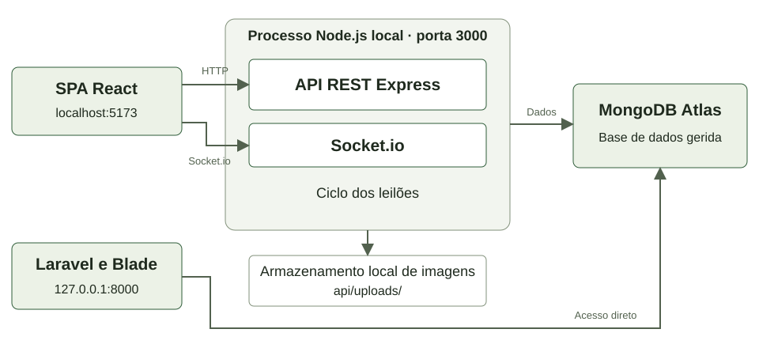
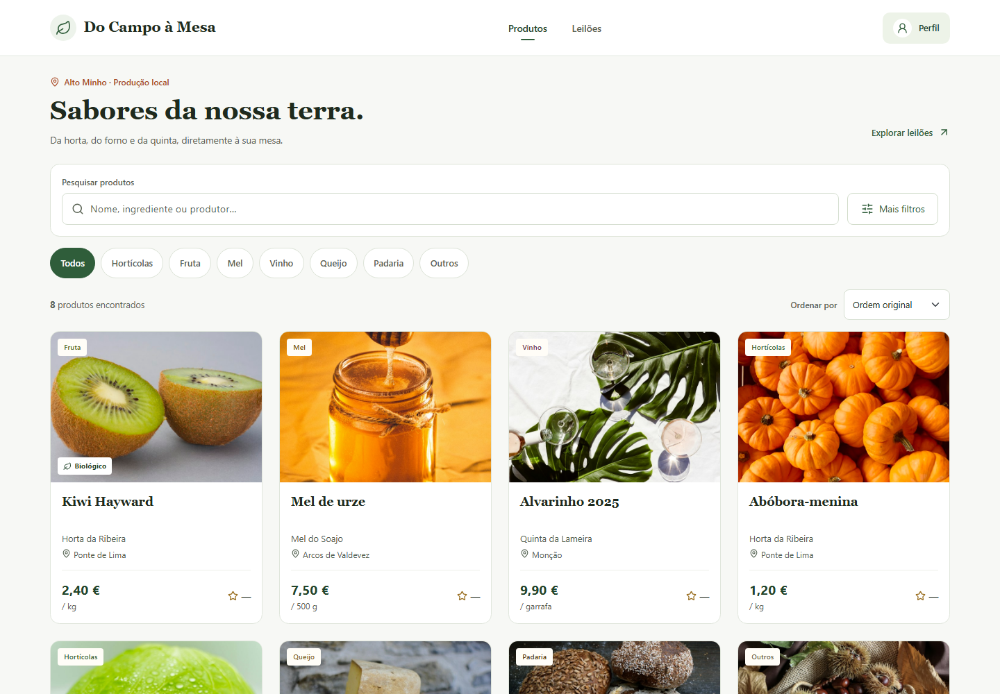
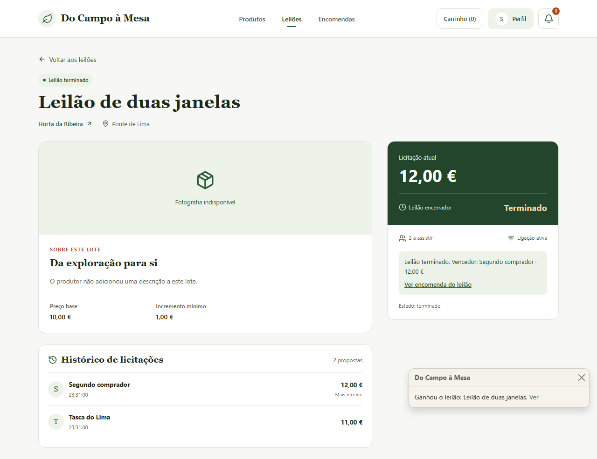
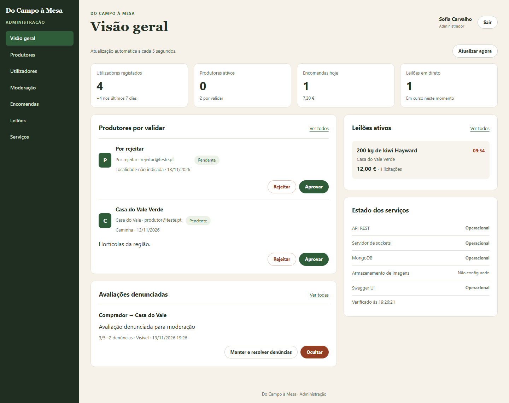

<!-- Exportação de referência: A4, com relatorio/impressao.css e as quebras HTML.
     Manter a pasta relatorio/figuras junto deste ficheiro.
     O Markdown não fixa o número de páginas em todos os conversores. -->

# Do Campo à Mesa

## Relatório

**Unidade curricular** Desenvolvimento Web e para a Cloud<br>
**Curso** Mestrado em Engenharia Informática<br>
**Instituição** UNIPVC ESTG<br>
**Autor** Pedro Soares Poças<br>
**Número de aluno** 28976<br>
**Data** Novembro de 2026

### Resumo

O projeto Do Campo à Mesa consiste numa aplicação web para a comercialização de produtos locais e a ligação entre produtores e compradores. Reúne a consulta de produtos e explorações, a realização de encomendas, a avaliação de compras entregues e a participação em leilões com atualização em tempo real. A área administrativa permite validar produtores, acompanhar a atividade e moderar avaliações denunciadas.

A solução articula uma aplicação de página única (SPA) em React com uma API REST em Node.js e Express, uma base de dados MongoDB e comunicação em tempo real através de Socket.io. Um backoffice desenvolvido em Laravel complementa a administração e acede à mesma base de dados. A interface segue uma abordagem Mobile First, com componentes e estilos adaptados a telemóveis e computadores.

O principal desafio técnico incidiu na consistência dos leilões perante licitações simultâneas. A implementação combina atualizações condicionais e transações MongoDB para manter a correspondência entre o valor atual, o histórico de licitações e a encomenda do vencedor. A validação recorre a testes da API e do Laravel, complementados por testes de ponta a ponta com Playwright.

A SPA, a API e o backoffice são executados localmente, com persistência no MongoDB Atlas. Os testes automatizados utilizam bases temporárias independentes da base da aplicação.

<div style="break-after: page; page-break-after: always;"></div>

## Índice

1. [Introdução e âmbito](#1-introdução-e-âmbito)
2. [Arquitetura da solução](#2-arquitetura-da-solução)
3. [Frontend e aplicação de página única](#3-frontend-e-aplicação-de-página-única)
4. [API REST e documentação](#4-api-rest-e-documentação)
5. [Modelo de dados e persistência](#5-modelo-de-dados-e-persistência)
6. [Segurança e controlo de acesso](#6-segurança-e-controlo-de-acesso)
7. [Encomendas, avaliações e moderação](#7-encomendas-avaliações-e-moderação)
8. [Tempo real e consistência dos leilões](#8-tempo-real-e-consistência-dos-leilões)
9. [Administração e backoffice Laravel](#9-administração-e-backoffice-laravel)
10. [Validação e resultados](#10-validação-e-resultados)
11. [Ambiente de execução e configuração](#11-ambiente-de-execução-e-configuração)
12. [Dificuldades, limitações e evolução](#12-dificuldades-limitações-e-evolução)
13. [Ferramentas e utilização de IA](#13-ferramentas-e-utilização-de-ia)
14. [Conclusão e referências](#14-conclusão-e-referências)

### Organização do relatório

O relatório apresenta os objetivos e a arquitetura do projeto, seguidos das decisões relativas à interface, à API, à persistência e à segurança. A descrição das encomendas, dos leilões e da administração estabelece a ligação entre essas decisões e os percursos de utilização. As secções finais apresentam os resultados da validação, as condições de execução e as limitações identificadas, bem como as possibilidades de evolução.

As capturas do catálogo utilizam os dados JSON de exemplo incluídos no projeto. As capturas dos leilões e da administração provêm de ambientes de teste isolados. Os nomes, quantidades e valores apresentados correspondem a cenários de validação e demonstração académica.

O guia de implementação constitui a referência técnica principal [1]. A descrição da solução e a análise dos resultados baseiam-se no código e nos testes do repositório [2–5].

<div style="break-after: page; page-break-after: always;"></div>

## 1 Introdução e âmbito

O projeto Do Campo à Mesa foi desenvolvido no âmbito da unidade curricular de Desenvolvimento Web e para a Cloud, com o objetivo de aplicar e consolidar os conteúdos teóricos e práticos abordados nas aulas. O desenvolvimento de uma aplicação web permitiu relacionar conceitos de organização de interfaces, comunicação entre cliente e servidor, persistência de dados, autenticação e atualização de informação em tempo real.

A aplicação reúne a divulgação de produtos locais, a realização de compras e a venda de lotes por leilão. O comprador consulta a origem dos artigos e acompanha as encomendas, enquanto o produtor gere a oferta e atualiza o estado dos pedidos. A administração assegura a validação de produtores e a moderação das avaliações denunciadas.

A concretização destes percursos envolve a integração de uma interface React, uma API REST em Node.js e Express, uma base de dados MongoDB e comunicação através de Socket.io. O backoffice Laravel permite aplicar PHP e o padrão Model-View-Controller (MVC) à gestão dos mesmos dados. A articulação destas tecnologias constitui uma oportunidade para compreender o seu funcionamento conjunto e consolidar os conhecimentos através da resolução de problemas de implementação e integração.

### Objetivos e intervenientes

| Perfil | Funcionalidades principais |
|---|---|
| Visitante | Consultar e pesquisar produtos, aplicar filtros, ver produtores, mapas e avaliações públicas |
| Comprador | Gerir carrinho, encomendar, acompanhar estados, avaliar compras entregues, denunciar avaliações e licitar |
| Produtor | Editar a exploração, gerir produtos e imagens, acompanhar encomendas, atualizar estados e criar leilões |
| Administrador | Aprovar ou rejeitar produtores, moderar avaliações e consultar indicadores, utilizadores, encomendas e leilões |

O visitante é um estado de acesso sem autenticação. Na base de dados existem três papéis: `comprador`, `produtor` e `admin`. Uma conta de produtor pode autenticar-se antes da aprovação, mas a publicação de novos produtos e leilões exige validação administrativa.

### Âmbito funcional

A implementação cobre catálogo, compras, avaliações, leilões, notificações e administração em ambiente local. Não inclui processamento de pagamentos nem integração com transportadoras. A opção de entrega regista a morada e o método escolhido, sem simular um serviço de expedição externo.

A SPA, a API, a Swagger UI e o backoffice Laravel são executados localmente, com persistência no MongoDB Atlas. A secção 11 descreve o ambiente de execução, os requisitos de instalação e a configuração necessária para utilizar a aplicação.

<div style="break-after: page; page-break-after: always;"></div>

## 2 Arquitetura da solução

A arquitetura distribui a interface pública, os serviços e a administração por três aplicações no mesmo repositório. A pasta `web/` contém a SPA, a pasta `api/` reúne os recursos REST e a comunicação por sockets, e a pasta `admin/` contém o backoffice Laravel. Esta organização atribui a cada aplicação dependências e configuração próprias.



*Figura 1. Componentes da solução, com execução local das aplicações, persistência no MongoDB Atlas e armazenamento local das imagens.*

A API e o Socket.io partilham o mesmo servidor HTTP. A aplicação Express disponibiliza o objeto `io` às rotas REST, permitindo notificar o produtor após uma compra e o comprador quando o estado da encomenda muda. O serviço responsável pelo ciclo de vida dos leilões utiliza o mesmo objeto para publicar eventos de abertura e encerramento.

O Laravel acede à mesma base MongoDB através de `mongodb/laravel-mongodb`. A aprovação de produtores feita no Laravel é observada por um change stream no processo Node.js, que notifica o produtor na SPA.

Esta abordagem evita duplicar dados entre sistemas, mas exige compatibilidade de campos, coleções e regras de negócio. Os testes de aprovação e moderação consultam os documentos persistidos para verificar essa compatibilidade. As sessões Laravel são independentes dos JWT utilizados pela SPA.

<div style="break-after: page; page-break-after: always;"></div>

## 3 Frontend e aplicação de página única

### 3.1 Tecnologias e interface

A interface utiliza React 18 para construir componentes reutilizáveis, nomeadamente cartões de produtos, formulários e indicadores do estado das encomendas. O Vite 5 suporta o desenvolvimento e a compilação, enquanto o React Router gere a navegação entre páginas. Bootstrap 5.3 e SASS fornecem a base visual, complementada por variáveis e estilos próprios. A reutilização de componentes permite aplicar alterações de forma consistente nas diferentes áreas da aplicação.

A identidade visual utiliza verde, fundo claro e apontamentos em terracota. Os cartões apresentam preço, unidade, produtor, localidade e classificação. Catálogo, perfil, carrinho, leilões e administração mantêm critérios comuns de apresentação.

A abordagem Mobile First parte da apresentação em ecrãs pequenos e introduz adaptações através de media queries, com breakpoints principais de 768, 1024 e 1280 píxeis. A grelha do catálogo apresenta duas colunas em ecrãs pequenos, três a partir de 768 píxeis e quatro a partir de 1024 píxeis. A navegação inferior adapta-se ao papel do utilizador autenticado. Os estados das encomendas assumem uma disposição horizontal no computador e uma progressão vertical no telemóvel.



*Figura 2. Catálogo na interface atual, com os dados JSON locais de exemplo.*

A pesquisa abrange o nome do produto, os ingredientes e o produtor, podendo ser combinada com filtros de categoria, localidade, época, modo biológico e preço máximo, além de critérios de ordenação. A paginação do catálogo é realizada no cliente sobre a lista devolvida pela API. Esta opção limita a informação apresentada em cada página, embora transfira a lista completa de produtos. O crescimento do catálogo justificará a passagem da paginação para o servidor.

As páginas de detalhe do produto e do produtor incorporam Google Maps para apresentar a localização da exploração. Quando existem coordenadas, o mapa utiliza essa posição. Nos restantes casos, efetua uma pesquisa pela localidade em Portugal. A indicação textual da localidade e a ligação externa permitem consultar a localização mesmo quando o mapa incorporado está indisponível.

<div style="break-after: page; page-break-after: always;"></div>

### 3.2 Estado e navegação na SPA

Os contextos React centralizam o estado partilhado entre páginas e as regras de sessão, carrinho e comunicação. Esta organização permite reutilizar essas regras e reduz a passagem de propriedades por sucessivos níveis de componentes.

| Elemento | Responsabilidade |
|---|---|
| `AuthContext` | Autenticação, persistência da sessão, atualização do utilizador e expiração |
| `CarrinhoContext` | Produtos selecionados, quantidades e persistência do carrinho |
| `SocketContext` | Ligação Socket.io associada à sessão ativa |
| `NotificacoesContext` | Histórico, avisos temporários e notificações por ler |
| `useApi` | Pedidos, carregamento, erros e atualização dos dados |
| `useLeilao` e `useContagem` | Estado da sala, propostas, presença e contagem do tempo |

A sessão é guardada em `localStorage` e validada através de `/api/auth/eu` no arranque. O cliente agenda a saída após a expiração indicada no token, mas a verificação da assinatura e da validade pertence sempre ao servidor. As rotas protegidas controlam a navegação e a API volta a verificar as permissões.

O carrinho conserva os produtos e as quantidades entre recarregamentos da página. Durante a submissão, a interface apresenta eventuais erros de stock ou de comunicação e preserva o conteúdo em caso de falha. A API calcula o total com base nos preços dos produtos guardados na base de dados, assegurando que a compra utiliza os valores confirmados pelo servidor.

As páginas apresentam estados distintos de carregamento, ausência de resultados e erro, permitindo ao utilizador perceber o resultado de cada operação. Os efeitos React removem listeners Socket.io e temporizadores ao abandonar a página. A troca de conta substitui o contexto das notificações, evitando apresentar o histórico de outro utilizador.

O centro de notificações apresenta um sino com contador, ligações para os recursos associados e uma ação para marcar todas as entradas como lidas. O histórico conserva até 50 entradas por utilizador no navegador, enquanto os avisos temporários desaparecem após 12 segundos. A persistência local limita a consulta ao navegador utilizado e às notificações recebidas durante a ligação.

<div style="break-after: page; page-break-after: always;"></div>

## 4 API REST e documentação

A API Express organiza cada recurso num módulo de rotas. Os modelos validam documentos, os serviços concentram operações partilhadas e o middleware trata autenticação e erros. A separação entre `app.js` e `server.js` permite testar a aplicação sem usar o servidor habitual de desenvolvimento.

A especificação `api/openapi.yaml` utiliza OpenAPI 3.0.3. A validação identifica **23 caminhos e 29 operações**. A Swagger UI está disponível localmente em [http://localhost:3000/api-docs](http://localhost:3000/api-docs) e a especificação em [http://localhost:3000/openapi.json](http://localhost:3000/openapi.json).

| Recurso | Operações principais |
|---|---|
| `/api/auth` | Registo, login e consulta do utilizador autenticado |
| `/api/products` | Consulta, filtros, criação, alteração, eliminação e imagem |
| `/api/producers` | Lista, página pública e alteração da exploração do próprio produtor |
| `/api/orders` | Criação, consulta e avanço do estado de encomendas |
| `/api/auctions` | Lista, criação, detalhe e histórico de licitações |
| `/api/reviews` | Consulta, publicação de avaliações e denúncias |
| `/api/admin` | Indicadores, validação de produtores e moderação |
| `/api/health` | Verificação básica da API |

`GET` consulta recursos, `POST` cria registos ou executa ações, `PUT` altera campos permitidos de um produto, `PATCH` atualiza parcialmente perfis ou estados e `DELETE` elimina um produto. A criação de produtos e leilões devolve `201` e o cabeçalho `Location`.

Os erros distinguem dados inválidos (`400`), falta de autenticação (`401`), papel sem autorização (`403`), recurso inexistente ou inacessível (`404`) e conflito de estado, stock ou duplicação (`409`). Os pedidos JSON que excedem o limite de tamanho devolvem `413`. Nos uploads, os erros de tamanho tratados pelo Multer devolvem `400`. As respostas apresentam mensagens compreensíveis, sem expor credenciais da base de dados.

O contrato define os formatos e os limites das respostas, incluindo a devolução das 20 licitações mais recentes no detalhe de um leilão. A sala React recebe as atualizações de estado por Socket.io, enquanto os endpoints REST permitem a consulta e a integração com outros clientes. A secção 8 apresenta os eventos utilizados na comunicação em tempo real.

<div style="break-after: page; page-break-after: always;"></div>

## 5 Modelo de dados e persistência

O modelo de dados organiza-se em seis coleções, designadas `users`, `products`, `orders`, `auctions`, `bids` e `reviews`. Os esquemas Mongoose validam os tipos, os campos obrigatórios, os limites e os valores admitidos. As relações entre documentos utilizam `ObjectId`, enquanto os conjuntos pequenos de dados habitualmente consultados em conjunto são embebidos no documento principal. A tabela seguinte apresenta as decisões de modelação e a respetiva justificação.

| Relação | Decisão e justificação |
|---|---|
| Utilizador e exploração | Dados embebidos em `users.produtor`, numa relação pequena de um para um |
| Encomenda e linhas | Linhas embebidas, com nome, preço, unidade e quantidade no momento da compra |
| Leilão e proposta atual | Proposta embebida para atualização conjunta com contador, prazo e estado |
| Leilão e histórico | Referências em `bids`, evitando crescimento ilimitado do documento do leilão |
| Produto e produtor | Referência ao utilizador, sem repetir dados alteráveis da exploração |
| Encomenda e intervenientes | Referências ao comprador e produtor, usados noutros contextos |
| Avaliações e compra | Coleção independente com referências a autor, produtor, encomenda e produto opcional |

As linhas da encomenda preservam os dados comerciais da compra. Uma alteração posterior do nome ou do preço do produto não modifica esse registo. O total é calculado a partir das linhas, com arredondamento a duas casas decimais.

Os índices acompanham os padrões de consulta mais frequentes. O email possui uma restrição de unicidade. Nos produtos, os índices abrangem o produtor, a categoria, o preço e as épocas, enquanto nos leilões abrangem o produtor, o estado e o prazo. As avaliações utilizam índices por produtor ou produto e visibilidade, além de um índice único parcial sobre a combinação de encomenda, autor e produto.

As consultas combinam `$regex`, `$lte`, `$in` e `$expr`. A pesquisa escapa caracteres especiais antes de construir a expressão regular, tratando a entrada como texto literal. As médias dos cartões de produtos incluem apenas avaliações visíveis associadas ao respetivo produto. A média apresentada na página do produtor agrega as avaliações visíveis associadas a esse produtor, incluindo as avaliações dos seus produtos.

Uma pesquisa por localidade obtém primeiro os identificadores dos produtores correspondentes e usa-os na consulta de produtos com `$in`. Pode combiná-los com categoria, preço e época. A ordenação inclui o identificador como desempate nas listagens relevantes.

Os índices não eliminam todos os custos de pesquisa. Expressões regulares sem prefixo fixo e listagens completas podem tornar-se dispendiosas com grandes volumes. A otimização deverá apoiar-se em medições, paginação no servidor e análise dos planos de execução.

<div style="break-after: page; page-break-after: always;"></div>

## 6 Segurança e controlo de acesso

A autenticação da API utiliza JWT com validade configurável, por omissão de duas horas. O token inclui identificador, nome e papel do utilizador. Cada pedido protegido verifica o token e as rotas restringem os papéis autorizados. A ligação Socket.io exige autenticação e os eventos de entrada e licitação verificam novamente a validade do token.

O registo público admite contas de comprador ou produtor e guarda as palavras-passe como hashes bcrypt com fator de trabalho 12. A restrição dos papéis disponíveis impede a criação de contas administrativas através dos dados submetidos pelo cliente. O campo `passwordHash` fica excluído das consultas habituais e das respostas serializadas.

O controlo de acesso inclui a propriedade dos recursos. A alteração de um produto procura simultaneamente o seu identificador e o produtor autenticado. As encomendas são filtradas pelo comprador ou produtor associado. Conhecer um identificador não concede acesso aos documentos de outro utilizador.

No Laravel, a autenticação utiliza sessão e cookies. A aplicação aceita os hashes bcrypt do MongoDB, regenera a sessão após login e invalida-a no logout. O middleware restringe o backoffice a administradores. Os formulários incluem proteção CSRF e o login tem limitação de tentativas.

As credenciais de acesso à base de dados e as chaves de segurança da aplicação são definidas nos ficheiros `.env` do servidor, excluídos do Git. O cliente recebe apenas configuração pública, como o endereço da API. A política CORS admite a origem configurada para a SPA. Os pedidos JSON têm limite de 1 MB e os uploads admitem JPEG, PNG ou WebP até 5 MB.

### Limites de segurança

A execução local utiliza HTTP. Uma eventual publicação exigiria HTTPS e revisão da configuração de produção. Guardar JWT em `localStorage` exige atenção a XSS, pois código executado na origem teria acesso ao token. A API Node.js não inclui a mesma limitação de tentativas de login já presente no Laravel.

A aceitação de imagens verifica o MIME declarado e o tamanho, sem uma análise aprofundada do conteúdo. A revogação imediata de tokens e o reforço dos uploads são melhorias possíveis. Os testes de autorização demonstram os cenários exercitados, sem constituírem uma auditoria completa de segurança.

<div style="break-after: page; page-break-after: always;"></div>

## 7 Encomendas, avaliações e moderação

O processo de compra permite selecionar produtos, quantidades e uma modalidade de receção, através de levantamento ou entrega. A entrega exige uma morada. Antes de criar as encomendas, a API agrega as linhas repetidas e valida se as quantidades são números inteiros positivos. Quando o carrinho inclui artigos de vários produtores, a compra origina uma encomenda por produtor.

A reserva de stock utiliza uma atualização condicional que verifica a disponibilidade antes de aplicar `$inc` com valor negativo. A operação exige um stock igual ou superior à quantidade solicitada. Desta forma, uma compra concorrente deixa de satisfazer a condição quando uma operação anterior já reduziu o stock abaixo da quantidade necessária.

Em caso de falha numa linha ou na criação de uma encomenda, a API remove as encomendas criadas durante o pedido e repõe o stock reservado. A consistência do carrinho completo depende, por isso, de operações compensatórias. Uma interrupção do processo ou uma falha na reposição pode comprometer essa compensação, constituindo uma limitação da implementação atual.

A encomenda percorre os estados `pendente`, `confirmada`, `pronta` e `entregue`. A interface apresenta a ação correspondente ao passo seguinte, enquanto a API permite avançar para um estado posterior e restringe a alteração ao produtor associado. Cada mudança gera um evento para atualizar a página do comprador e apresentar uma notificação. O cartão da encomenda apresenta os produtos, as quantidades, os preços unitários, o total, a modalidade de receção e a progressão dos estados.

### Avaliação e moderação

A publicação de uma avaliação exige uma encomenda entregue pertencente ao comprador autenticado. A avaliação pode incidir sobre o produtor ou sobre um produto incluído na compra, com uma classificação inteira entre um e cinco. Um índice único impede a repetição da mesma combinação de encomenda, autor e produto.

A denúncia de uma avaliação exige autenticação e regista o identificador do denunciante num conjunto. O contador aumenta apenas quando esse utilizador apresenta a primeira denúncia sobre a avaliação. A condição integra a atualização MongoDB, impedindo a contagem duplicada de pedidos simultâneos. A resposta pública omite os identificadores dos denunciantes.

O administrador pode ocultar, repor ou manter a avaliação e resolver as denúncias. Ocultar preserva o documento e permite rever a decisão. As médias e listas públicas excluem avaliações ocultas. O carregamento repetido dos dados iniciais de avaliações preserva as decisões de moderação anteriores.

<div style="break-after: page; page-break-after: always;"></div>

## 8 Tempo real e consistência dos leilões

### 8.1 Salas e contrato de eventos

O Socket.io organiza as ligações em salas de utilizador e de leilão. Após a autenticação, cada utilizador entra na sala `user:ID`, destinada a notificações privadas. A sala `leilao:ID` reúne os participantes de um leilão e recebe as atualizações de propostas, presença e encerramento.

| Direção e destino | Evento | Conteúdo e finalidade |
|---|---|---|
| Cliente para servidor | `entrar`, `sair` | Identificador do leilão e participação |
| Cliente para servidor | `licitar` | `leilaoId`, `valor` e confirmação de aceitação ou erro |
| Servidor para cliente | `estado` | Hora do servidor, leilão e últimas 20 licitações |
| Servidor para cliente | `recusada` | Motivo da rejeição |
| Servidor para sala | `presenca` | Número de ligações presentes |
| Servidor para sala | `nova-licitacao` | Licitação persistida e contador atualizado |
| Servidor para sala | `aberto`, `terminado` | Abertura ou resultado final |
| Servidor para comprador | `encomenda-atualizada` | Encomenda, estado e produtor |
| Servidor para produtor | `nova-encomenda` | Identificador e total |
| Servidor para intervenientes | `leilao-ganho`, `leilao-terminado` | Lote, valor, vencedor e encomenda, quando aplicável |
| Servidor para produtor | `conta-validada` | Identificador da conta aprovada |

Ao entrar na sala, o cliente recebe a hora do servidor e calcula a diferença face ao relógio local. A contagem utiliza essa diferença, mas a aceitação das propostas depende sempre do prazo verificado no servidor. A indicação visual é uma aproximação sujeita à latência da ligação.

A licitação exige que o socket esteja na sala correspondente. A presença conta ligações, não pessoas distintas, porque uma pessoa pode abrir várias janelas. Na reconexão, o cliente volta a entrar e recebe o estado atual e o histórico recente.

As aprovações escritas pelo Laravel são observadas por um change stream na coleção `users`. A alteração desencadeia `conta-validada` para a sala do produtor. Este mecanismo e as transações exigem suporte a replica set no MongoDB.

<div style="break-after: page; page-break-after: always;"></div>

### 8.2 Consistência das licitações

A função `licitar`, implementada em `api/src/services/tempoReal.js`, processa a aceitação de propostas numa transação MongoDB. A operação exige que o leilão esteja ativo, tenha começado e permaneça dentro do prazo. A atualização verifica ainda se a proposta atinge o valor atual acrescido do incremento mínimo, aplicando arredondamento monetário.

Quando essas condições são satisfeitas, a operação substitui a proposta atual, incrementa o contador e insere a licitação na coleção `bids`, dentro da mesma transação. Após a conclusão da função transacional, o servidor emite o evento `nova-licitacao` para os participantes.

Com valor atual de 100 € e incremento de 5 €, duas propostas simultâneas de 105 € não podem ser ambas aceites. Após a primeira atualização, o mínimo passa a 110 €. A outra proposta deixa de satisfazer a condição e é recusada. Esta verificação depende do estado confirmado no MongoDB, em vez de uma leitura anterior do cliente.

### 8.3 Abertura, fecho e entrega dos eventos

O serviço responsável pelo ciclo de vida dos leilões executa-se, por omissão, a cada dois segundos, abrindo os leilões agendados e encerrando os ativos cujo prazo terminou. A verificação temporal aplicada a cada licitação impede a aceitação de propostas após o prazo, mesmo no intervalo entre duas execuções do serviço.

O fecho altera condicionalmente o estado e cria a encomenda do vencedor na mesma transação. A encomenda fica confirmada, com origem `leilao`, uma linha para o lote e o valor vencedor. A sua referência fica no leilão. O encerramento sem propostas termina o leilão sem atribuir um vencedor. Chamadas repetidas ao ciclo preservam a existência de uma única encomenda por fecho com vencedor.



*Figura 3. Teste com dois compradores, histórico e acesso à encomenda do vencedor.*

A confirmação dos dados e a entrega das mensagens são garantias diferentes. Uma falha entre a confirmação da transação e a emissão Socket.io pode impedir a notificação. A reconexão recupera o estado atual, mas não existe uma fila persistente de eventos.

<div style="break-after: page; page-break-after: always;"></div>

## 9 Administração e backoffice Laravel

A administração está disponível na SPA e numa aplicação Laravel 13. O painel React aprova ou rejeita produtores, modera avaliações e apresenta indicadores e leilões. As listas administrativas têm paginação e os indicadores e leilões são atualizados a cada cinco segundos enquanto a página está visível.

O backoffice Laravel organiza-se em controladores, modelos MongoDB e vistas Blade. Disponibiliza uma visão geral da atividade e áreas de produtores, utilizadores, moderação, encomendas, leilões e serviços. As listagens detalhadas incluem filtros e paginação de 20 registos, enquanto a página inicial apresenta resumos com ligações para essas listagens.



*Figura 4. Backoffice no ambiente de teste, com validação, moderação e estado dos serviços.*

No Laravel, a validação exige que o pedido continue pendente, evitando substituir uma decisão concorrente por uma ação antiga. A rota equivalente da API Express verifica o identificador e o papel do produtor, mas não impõe a mesma condição de pendência. A moderação preserva a avaliação e altera a visibilidade ou resolve as denúncias. Os indicadores usam o dia local de Lisboa.

A página de serviços verifica respostas da API, Socket.io, MongoDB, Swagger UI e armazenamento configurado. A ausência de configuração não é apresentada como serviço operacional. A página ajuda a diagnosticar falhas locais, sem substituir monitorização contínua ou métricas de produção.

A interoperabilidade entre o Laravel e a SPA assenta nos dados dos utilizadores, nos hashes de autenticação e nos documentos partilhados. Cada aplicação mantém a sua própria sessão. Com os serviços em execução, o change stream deteta uma aprovação efetuada no Laravel e o Socket.io comunica-a ao produtor na SPA.

<div style="break-after: page; page-break-after: always;"></div>

## 10 Validação e resultados

### 10.1 Estratégia e ambientes

A estratégia de validação combina testes da API e do Laravel com percursos de utilização automatizados em Playwright. As suites criam bases MongoDB e serviços temporários para executar as verificações em ambientes isolados. Os testes de concorrência utilizam um replica set, necessário à execução das transações. A demonstração gravada utiliza contas de exemplo na base MongoDB Atlas da aplicação.

A execução de `npm test` na pasta `api/` concluiu com **35 testes aprovados e nenhuma falha**. O resumo seguinte reproduz a saída obtida.

```text
# tests 35
# suites 0
# pass 35
# fail 0
# cancelled 0
# skipped 0
# todo 0
# duration_ms 20037.8937
```

A contagem apresentada pelo Node.js inclui testes agregadores e subtestes. Os percursos de interface são executados separadamente com Playwright, conforme os resultados apresentados na tabela seguinte.

| Verificação | Resultado observado |
|---|---|
| API e persistência, `npm test` | 35 testes aprovados, sem falhas |
| Laravel com MongoDB temporário | 19 testes aprovados e 123 asserções |
| OpenAPI, `npm run docs:validate` | 23 caminhos e 29 operações válidas |
| Compilação React, `npm run build` | Compilação concluída |
| Playwright da SPA e sockets | 62 verificações aprovadas em Chromium |
| Playwright do carrinho em computador | 13 verificações aprovadas |
| Playwright do Laravel | Percurso concluído, incluindo cinco listas com paginação e sete páginas em telemóvel |

Cada linha apresenta o resultado do respetivo conjunto de verificações. As contagens distinguem testes, asserções e percursos de interface, pelo que devem ser interpretadas no contexto de cada ferramenta.

<div style="break-after: page; page-break-after: always;"></div>

### 10.2 Cobertura e reprodução

O teste de licitações simultâneas envia duas propostas de 105 € através de `Promise.allSettled`, confirma a aceitação de uma única proposta e verifica o histórico. Um segundo cenário envia dez propostas concorrentes e compara o número de aceitações com os documentos `bids`, o contador e o valor final. A repetição do fecho constitui outro cenário de teste, que verifica a criação de uma única encomenda.

O Playwright exercita ainda o cenário através de Socket.io e da interface, incluindo salas isoladas, reconexão, presença e anúncio do vencedor. A responsividade é verificada em 14 páginas da SPA a 320, 375, 768, 1024 e 1280 píxeis. No Laravel, são verificadas as sete páginas principais a 320 e 390 píxeis, além da utilização em computador.

A cobertura inclui autorização, stock, moderação, mapas, paginação, notificações e erros. Os resultados reportados da suite integral referem-se ao Chromium. Não foram realizados testes de carga em produção nem uma auditoria formal de acessibilidade.

Para reproduzir os percursos, a API disponibiliza `npm run test:e2e` e `npm run test:browser:carrinho-desktop`. No Laravel, `composer run test:mongodb` executa os testes com base temporária.

### 10.3 Demonstração funcional

O vídeo de demonstração tem **4 minutos e 50 segundos**, sem áudio. A gravação identifica as contas e os papéis utilizados ao longo dos percursos de visita, compra, gestão de encomendas e criação de leilões. Apresenta a participação de dois compradores em sessões independentes e a administração em React e Laravel. A parte final mostra os filtros, a localização, a avaliação de uma compra entregue, a denúncia, a decisão administrativa e o histórico de notificações.

A demonstração mobile apresenta o catálogo em duas colunas, a navegação inferior, os filtros e a progressão vertical dos estados das encomendas. A gravação utiliza Chromium com emulação de um ecrã de 390 × 844 píxeis. A composição reúne capturas reais da aplicação e legendas de identificação, preservando a velocidade dos acontecimentos apresentados.

As contas e os registos utilizados no vídeo estão identificados como dados de demonstração. As compras, licitações e decisões administrativas ficam persistidas na base Atlas da aplicação. O vídeo encontra-se em `docs/demonstracao-do-campo-a-mesa.mp4` e integra os elementos de apoio à entrega.

<div style="break-after: page; page-break-after: always;"></div>

## 11 Ambiente de execução e configuração

O ambiente de execução integra três serviços locais. O Vite disponibiliza a interface React no navegador, o servidor Node.js executa a API Express e o Socket.io, e o servidor PHP disponibiliza o backoffice Laravel. A interface React comunica com a API e com o Socket.io. A API e o Laravel acedem à mesma base de dados MongoDB Atlas, permitindo consultar e gerir a informação através das duas aplicações. A tabela seguinte apresenta os endereços de acesso e os recursos utilizados.

| Componente | Localização ou serviço | Enquadramento |
|---|---|---|
| React e Vite | `http://localhost:5173` | Servidor local de desenvolvimento |
| Express e Socket.io | `http://localhost:3000` | Processo Node.js local |
| Laravel | `http://127.0.0.1:8000` | Servidor PHP local |
| MongoDB Atlas | Cluster MongoDB | Base de dados gerida, DBaaS |
| Imagens dos produtos | `api/uploads/` | Sistema de ficheiros local |

### Instalação e arranque

A execução requer Node.js 20.19 ou superior, npm, PHP 8.3 ou superior, Composer 2 e a extensão PHP `mongodb`. Após a instalação das dependências e a configuração dos ficheiros `.env`, o arranque dos serviços utiliza os comandos seguintes em terminais separados, inicialmente posicionados na raiz do projeto.

```powershell
# Terminal 1, a partir da raiz
cd api
npm run dev

# Terminal 2, a partir da raiz
cd web
npm run dev

# Terminal 3, a partir da raiz
cd admin
composer run dev
```

O README descreve a instalação inicial e os campos de configuração. API e Laravel devem selecionar a mesma base. O `JWT_SECRET` pertence apenas ao servidor. As variáveis `VITE_` são lidas no arranque ou compilação. O seed completo apaga e recria coleções, pelo que não deve ser repetido numa base que se pretenda preservar.

### Recursos de execução

A execução da SPA, da API e do backoffice utiliza os recursos de processamento e memória do computador de desenvolvimento. As imagens dos produtos são guardadas na pasta local `api/uploads/`. O MongoDB Atlas disponibiliza a base de dados como serviço gerido (DBaaS), permitindo que a API e o Laravel consultem e atualizem os mesmos documentos. O acesso à base de dados requer uma ligação à Internet e a autorização do endereço IP do computador na configuração de rede do Atlas.

<div style="break-after: page; page-break-after: always;"></div>

## 12 Dificuldades, limitações e evolução

A integração entre a API Node.js e o Laravel exigiu compatibilidade entre os esquemas Mongoose e os modelos do adaptador Eloquent. A utilização das mesmas coleções, campos de aprovação e hashes de palavras-passe foi essencial para permitir que as operações de uma aplicação fossem reconhecidas pela outra. Os testes de autenticação e persistência verificam essa compatibilidade.

A seleção da base de dados constituiu outra dificuldade de integração. Um URI MongoDB sem o nome pretendido pode conduzir à utilização de uma base por omissão. Para verificar a seleção da base utilizada pela API, os testes da configuração Laravel abrangem diferentes formatos de URI. As instruções de instalação descrevem os campos necessários a essa configuração.

Nos leilões, uma sequência de leitura e escrita permitiria decisões concorrentes sobre um valor desatualizado. A atualização condicional e a transação resolvem a aceitação e a persistência conjunta. O fecho aplica a mesma abordagem para impedir encomendas duplicadas. Os testes não exigem um vencedor específico, porque a ordem dos pedidos é variável.

Na interface, a adaptação a telemóveis exigiu ajustar formulários, cartões e tabelas à largura disponível. As verificações a 320 píxeis permitiram identificar elementos que ultrapassavam os limites do ecrã. A introdução de paginação, sobretudo na administração, reduziu o volume de informação apresentado em simultâneo.

### Limitações e prioridades de evolução

As prioridades de evolução incluem paginação do catálogo no servidor, uma transação para todo o checkout e notificações persistidas no backend, recuperáveis após períodos sem ligação. Um registo persistente de eventos associado às transações reduziria a janela entre confirmação dos dados e emissão da mensagem.

Uma execução em várias instâncias exigiria coordenação Socket.io, com um adaptador partilhado e avaliação da presença entre processos. A consistência das transações MongoDB não fornece essa coordenação. Seriam ainda necessários testes de carga, observabilidade e HTTPS.

O reforço da autenticação da API, a validação do conteúdo real das imagens e uma auditoria de acessibilidade complementariam os testes. A eventual publicação das aplicações exigiria ainda armazenamento durável para as imagens e configuração adequada do ambiente de produção.

<div style="break-after: page; page-break-after: always;"></div>

## 13 Ferramentas e utilização de IA

As dependências estão identificadas nos ficheiros `package.json` e `composer.json`, com as versões concretas registadas nos respetivos ficheiros de lock. As tecnologias principais são React, Vite, React Router, Bootstrap, SASS, Express, Mongoose, Socket.io, bcryptjs, jsonwebtoken, Laravel e o adaptador MongoDB para Laravel.

O Git foi utilizado para o controlo de versões do projeto, permitindo registar as alterações ao código através de commits. O repositório encontra-se alojado no GitHub, onde é possível consultar o código e o histórico de desenvolvimento. A Swagger UI permite consultar e experimentar a API OpenAPI. Node.js test runner, PHPUnit, Playwright e `mongodb-memory-server` suportam a validação. A gravação combina Playwright e processamento de vídeo com FFmpeg. Os dados iniciais e os testes facilitam a reprodução de cenários com compradores, produtores e administração.

### Declaração de utilização de inteligência artificial

Durante o desenvolvimento do projeto, foi utilizado o assistente de inteligência artificial Codex, da OpenAI, integrado no ambiente de desenvolvimento (IDE). Esta ferramenta prestou apoio à implementação de algumas funcionalidades, à melhoria do design da interface e à preparação de testes automatizados. A sua utilização abrangeu também a revisão da documentação e a preparação e revisão do texto do relatório, bem como a gravação e a composição do vídeo de demonstração.

<div style="break-after: page; page-break-after: always;"></div>

## 14 Conclusão e referências

O desenvolvimento do projeto Do Campo à Mesa permitiu implementar as funcionalidades previstas para os diferentes perfis de utilização, desde a consulta de produtos pelo visitante até à compra, à gestão da atividade do produtor e à administração da plataforma. A integração destes percursos numa única aplicação permitiu relacionar as necessidades de cada perfil com as decisões técnicas adotadas.

O projeto permitiu também aplicar e consolidar os conceitos abordados nas aulas teóricas e práticas, através da utilização de tecnologias como PHP, Laravel, React, MongoDB e Socket.io. A articulação entre a interface, a API, a base de dados e a comunicação em tempo real contribuiu para uma compreensão mais aprofundada do desenvolvimento de aplicações web. A resolução dos problemas de integração e a realização de testes reforçaram ainda a importância da organização do código, do controlo de acesso e da consistência dos dados.

### Referências

[1] **Guia de Implementação Do Campo à Mesa**. Material de Desenvolvimento Web e para a Cloud, Mestrado em Engenharia Informática, IPVC ESTG. Ficheiro fornecido com o trabalho. Arquitetura e tecnologias, pp. 4–5; modelo de dados, p. 48; eventos, p. 69; consistência, pp. 79 e 91; Cloud, pp. 81 e 87; relatório e entrega, pp. 92–94.

[2] **Repositório Do Campo à Mesa**. Projeto de Pedro Soares Poças. [GitHub](https://github.com/Pedro-P26/DWC_do_campo_a_mesa). A análise considera o código da cópia local do projeto, incluindo as alterações posteriores ao commit `abcf763`.

[3] **API e modelo de dados**. `api/openapi.yaml`, `api/src/models/`, `api/src/routes/`, `api/src/services/tempoReal.js` e `api/src/sockets/`. Contratos e implementação das operações descritas.

[4] **Interface e administração**. `web/src/context/`, `web/src/hooks/`, `web/src/pages/`, `admin/app/` e `admin/routes/web.php`. Estado, navegação e regras do backoffice.

[5] **Validação do projeto**. `api/test/*.test.js`, `api/test/e2e/`, `admin/tests/` e `admin/scripts/test-mongodb.cjs`. As capturas e os resultados apresentados foram recolhidos em execução local.
